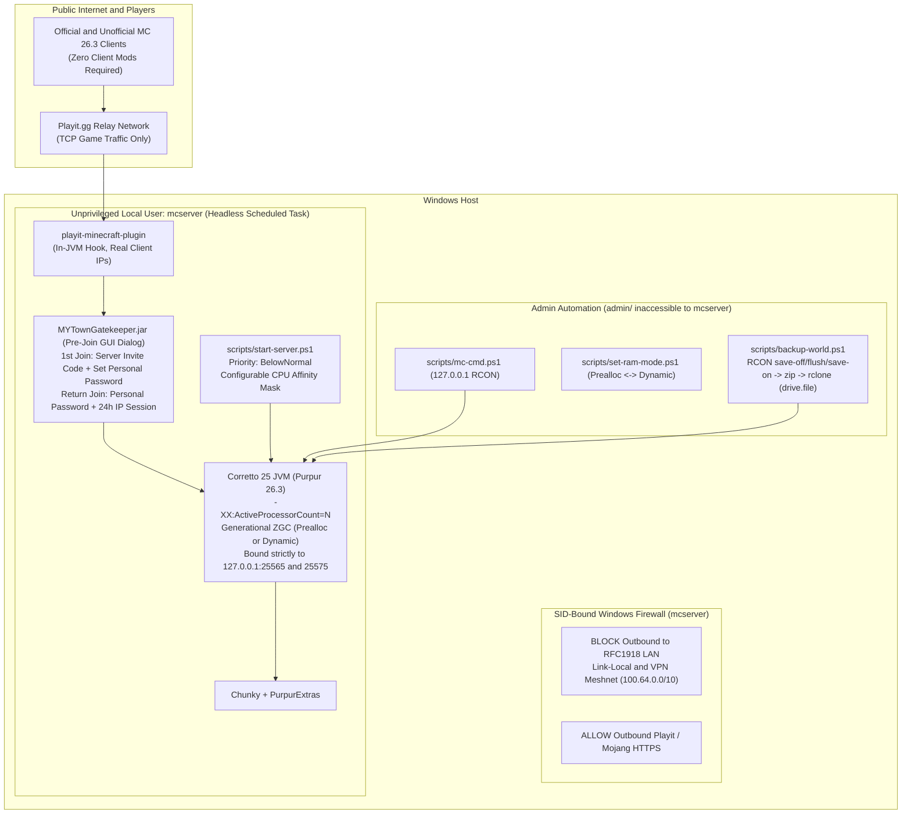

# MY-Town — Security-Hardened Windows Minecraft Server (Purpur 26.3)

A security-first, zero-port-forwarding Windows setup for hosting a **Purpur 26.3** Minecraft server for friends on a personal PC—supporting **both official and unofficial Minecraft clients** with **zero client-side mods**, strict **OS/network isolation**, **CPU core pinning**, **elastic/preallocated Generational ZGC RAM toggling**, and **least-privilege daily Google Drive backups**.

The repository mirrors the complete server directory structure (`admin/`, `config/`, `plugins/`, `scripts/`, `src/`, `Corretto/`, `backups/`, `logs/`, plus `server.properties`, `purpur.yml`, `bukkit.yml`, `spigot.yml`, `commands.yml`, `eula.txt`, and empty player lists) with **all secrets replaced by `CHANGE-ME-*` placeholders** and **third-party binaries excluded** so anyone can clone it, swap in real secrets (automatically or manually), drop in/download the third-party `.jar`s and JDK, and deploy cleanly.

---

## Repository Layout

| Path | Tracked in Git | Purpose |
| :--- | :---: | :--- |
| [`admin/`](admin) | Yes (sanitized) | Sanitized placeholder files (`mcserver-password.txt`, `rcon-secret.txt`, `invite-code.txt`, `rclone.conf`, `info.txt`). Locked down by `harden-environment.ps1` so `mcserver` is explicitly denied access. |
| [`plugins/MYTownGatekeeper.jar`](plugins/MYTownGatekeeper.jar) | Yes (1st-party) | Pre-built Gatekeeper plugin compiled from [`src/MYTownGatekeeper`](src/MYTownGatekeeper). |
| [`plugins/`](plugins) | Configs only | Pre-tuned plugin configs (`MYTownGatekeeper/`, `playit-gg/`, `Chunky/`, `PurpurExtras/`). Drop third-party `.jar`s here (ignored by `.gitignore`). |
| [`config/`](config), `purpur.yml`, `server.properties` | Yes | Hardened & casual-friendly Paper/Purpur defaults (`server-ip=127.0.0.1`, `online-mode=false`, `white-list=false`, `hide-online-players=true`, `pause-when-empty-seconds=60`, `creeper.allow-griefing: false`). |
| [`scripts/`](scripts) | Yes | Portable PowerShell automation (`bootstrap-server.ps1`, `build-gatekeeper.ps1`, `harden-environment.ps1`, `start-server.ps1`, `set-ram-mode.ps1`, `mc-cmd.ps1`, `backup-world.ps1`, `ram-mode.json`). |
| [`Corretto/`](Corretto) | README only | Optional local JDK 25 folder (extract Amazon Corretto 25 here, or install system-wide). |
| [`backups/`](backups), [`logs/`](logs) | `.gitkeep` only | Runtime backup archives and logs (ignored by `.gitignore`). |

> **Important:** Once you replace the `CHANGE-ME-*` placeholders in `admin/`, `server.properties`, and `plugins/MYTownGatekeeper/config.yml` with your real secrets, **never commit or push your live secrets** to a public fork.

---

## Security & Isolation Architecture



### Defense-in-Depth Highlights

| Layer | Control | Purpose |
| :--- | :--- | :--- |
| **Account Isolation** | Dedicated local user `mcserver` (`Users` only, `UserMayChangePassword = $false`) | Even if a plugin or JVM exploit occurs, the process has zero Administrator or privileged group rights. |
| **NTFS ACLs** | `admin/` and `backups/` explicitly **Deny** `mcserver`; `scripts/`, `Corretto/`, `libraries/`, `versions/`, `plugins/` root, `purpur-*.jar`, and `plugins/*.jar` are **Read & Execute (`RX`) only** (only named plugin data subdirectories are writable), and non-system volume roots deny sibling access | Prevents the game server from reading RCON/rclone secrets, tampering with backups, accessing sibling folders on the volume, or dropping/overwriting `.jar` binaries and startup scripts. |
| **SID Firewall** | Windows Defender Firewall rules bound to `mcserver`'s SID (`D:(A;;CC;;;<SID>)`) | Blocks `mcserver` from initiating outbound connections to RFC1918 LAN subnets (`10.0.0.0/8`, `172.16.0.0/12`, `192.168.0.0/16`), link-local (`169.254.0.0/16`), and VPN Meshnet/CGNAT (`100.64.0.0/10`), plus blocks direct inbound connections to `java.exe`. |
| **Loopback Binding** | `server-ip=127.0.0.1` in `server.properties` | Exposes neither the game port (`25565`) nor RCON (`25575`) on LAN or VPN interfaces. |
| **In-JVM Tunneling** | `playit-minecraft-plugin.jar` inside the unprivileged JVM | Unlike the standalone `playit` daemon (which can map arbitrary localhost/LAN ports from the web dashboard), the plugin only routes Minecraft TCP traffic and preserves real player IPs for logging and rate-limiting. |
| **Least-Privilege Backups** | `rclone` configured under Admin context with `scope = drive.file` | Restricts Google Drive OAuth access strictly to the `MY-Town-Backups` folder created by `rclone`; `mcserver` cannot read `admin/rclone.conf`. |

---

## `MYTownGatekeeper` Pre-Join GUI Authentication

Compiled in [`plugins/MYTownGatekeeper.jar`](plugins/MYTownGatekeeper.jar) from [`src/MYTownGatekeeper`](src/MYTownGatekeeper), this zero-dependency Purpur 26.3 plugin hooks into Paper's **Configuration-Phase Dialog API** (`AsyncPlayerConnectionConfigureEvent`, `PlayerCustomClickEvent`, `io.papermc.paper.dialog.Dialog`) so connecting players cannot load world chunks, spawn entities, or type in chat until authenticated:

1. **Both Official & Unofficial Clients Supported (`online-mode=false`):** Friends don't need client-side mods or manual whitelisting.
2. **First-Time Registration Modal:** Prompts for two secrets in a native Minecraft GUI dialog:
   - **Server Invite Code** (verified in constant time using `MessageDigest.isEqual`) — keeps automated server scanners and uninvited users out without maintaining a whitelist.
   - **Personal Account Password** (hashed with salted `PBKDF2WithHmacSHA256`, 65,536 iterations, 16-byte `SecureRandom` salt) — prevents anyone else (even another invited friend) from impersonating your username or another player's username.
3. **Returning Player Login Modal:** Automatically resumes valid IP sessions within `session-ttl-hours` (default `24`) or prompts for the player's personal password.
4. **Brute-Force Lockout:** Enforces configurable failed-attempt lockouts (`max-failed-attempts: 5`, `lockout-minutes: 15`) per real IP and username, rejecting locked-out IPs at `PlayerConnectionValidateLoginEvent`.

---

## Third-Party Binaries Required (Not Bundled)

| Component | Official Source | Where to Place |
| :--- | :--- | :--- |
| **Amazon Corretto 25 JDK** | [aws.amazon.com/corretto](https://aws.amazon.com/corretto/) | Extract under [`Corretto/`](Corretto) (e.g., `Corretto\jdk25.0.5_0`) or install system-wide. |
| **Purpur 26.3** | [purpurmc.org/downloads](https://purpurmc.org/downloads) | Server root as `purpur-26.3-*.jar` (or fetched automatically via `-DownloadDeps`). |
| **Playit.gg Minecraft Plugin** | [github.com/playit-cloud/playit-minecraft-plugin/releases](https://github.com/playit-cloud/playit-minecraft-plugin/releases) | `plugins\playit-minecraft-plugin.jar` (or fetched via `-DownloadDeps`). Do **not** run standalone `playit.exe`. |
| **Chunky** | [modrinth.com/plugin/chunky](https://modrinth.com/plugin/chunky) | `plugins\Chunky-Paper-*.jar` (or fetched via `-DownloadDeps`). |
| **PurpurExtras** | [modrinth.com/plugin/purpurextras](https://modrinth.com/plugin/purpurextras) | `plugins\PurpurExtras-*.jar` (or fetched via `-DownloadDeps`). |
| **Rclone** | [rclone.org/downloads](https://rclone.org/downloads/) (`winget install Rclone.Rclone`) | Required on PATH / WinGet Links for `scripts\backup-world.ps1`. |

---

## Quick Start Deployment

### 1. Clone & Install Prerequisites
```powershell
git clone https://github.com/filipzarzynski/Minecraft-MY-Town.git MY-Town
cd MY-Town
```
Ensure **Amazon Corretto 25 JDK** is installed (or extracted inside `Corretto\`) and **Rclone** is installed (`winget install Rclone.Rclone`).

### 2. Bootstrap Secrets, Dependencies & Gatekeeper
Run `bootstrap-server.ps1` (pass `-DownloadDeps` to automatically download Purpur 26.3, Playit plugin, Chunky, and PurpurExtras from official APIs and verify SHA-512 hashes, or omit `-DownloadDeps` if you placed the `.jar`s manually):
```powershell
powershell -ExecutionPolicy Bypass -File .\scripts\bootstrap-server.ps1 -DownloadDeps -AcceptEula
```
*(Or manually replace every `CHANGE-ME-*` string in [`admin/`](admin), [`server.properties`](server.properties), [`eula.txt`](eula.txt), and [`plugins/MYTownGatekeeper/config.yml`](plugins/MYTownGatekeeper/config.yml) before running `bootstrap-server.ps1`.)*

`bootstrap-server.ps1` automatically:
- Replaces all `CHANGE-ME-*` secrets in `admin/` with fresh cryptographic values and syncs them into `server.properties` and `plugins/MYTownGatekeeper/config.yml`.
- Runs Paperclip (`-Dpaperclip.patchonly=true`) to unpack `libraries/` and `versions/`.
- Compiles `plugins/MYTownGatekeeper.jar` from source via [`scripts/build-gatekeeper.ps1`](scripts/build-gatekeeper.ps1).

### 3. Authorize Google Drive Backups (`drive.file` scope)
```powershell
rclone config create gdrive drive scope drive.file --config .\admin\rclone.conf
```
Complete the one-time browser OAuth prompt. Because of `scope = drive.file`, `rclone` can only access files it creates inside `gdrive:MY-Town-Backups`.

### 4. Tune CPU Affinity & RAM Profile (Optional)
Edit [`scripts/ram-mode.json`](scripts/ram-mode.json) to match your CPU core count:
- **6-core CPU (no HT, reserve Cores 0–2 for desktop, pin JVM to Cores 3–5):** `"ActiveProcessorCount": 3, "AffinityMask": 56` (`0x38`)
- **8-core CPU (pin JVM to Cores 4–7):** `"ActiveProcessorCount": 4, "AffinityMask": 240` (`0xF0`)
- **12-thread CPU (pin JVM to Threads 6–11):** `"ActiveProcessorCount": 6, "AffinityMask": 4032` (`0xFC0`)

### 5. Harden Host, Firewall, ACLs & Start Server (Administrator PowerShell)
Open **Terminal (Admin)** and run:
```powershell
powershell -ExecutionPolicy Bypass -File .\scripts\harden-environment.ps1
```
This creates/hardens `mcserver`, locks NTFS ACLs, sets SID-bound firewall rules, grants `SeBatchLogonRight`, registers `MY-Town-Minecraft-Server` (boot startup) and `MY-Town-Daily-Backup` (`04:30 AM` daily), and starts the server.

### 6. Claim Playit.gg Tunnel
Find the one-time Playit claim link in `logs\latest.log`:
```powershell
Select-String -Path .\logs\latest.log -Pattern 'playit\.gg/claim'
```
Open it in your browser to link the tunnel to your Playit.gg account and obtain your public server address.

### 7. Apply Casual Gamerules & Pre-Generate Spawn
```powershell
# Friendly survival rules (Minecraft 26.3 snake_case gamerules)
.\scripts\mc-cmd.ps1 "gamerule keep_inventory true"
.\scripts\mc-cmd.ps1 "gamerule players_sleeping_percentage 25"
.\scripts\mc-cmd.ps1 "execute in minecraft:the_nether run gamerule keep_inventory true"
.\scripts\mc-cmd.ps1 "execute in minecraft:the_end run gamerule keep_inventory true"

# Grant yourself OP
.\scripts\mc-cmd.ps1 "op <YourUsername>"

# Pre-generate a 3,000-block Overworld radius with Chunky
.\scripts\mc-cmd.ps1 "chunky world world"
.\scripts\mc-cmd.ps1 "chunky center 0 0"
.\scripts\mc-cmd.ps1 "chunky radius 3000"
.\scripts\mc-cmd.ps1 "chunky start"
```
*(Creeper block-damage prevention `creeper.allow-griefing: false` is already pre-configured in [`purpur.yml`](purpur.yml).)*

---

## Day-to-Day Administration

```powershell
# Localhost RCON console commands
.\scripts\mc-cmd.ps1 "list"
.\scripts\mc-cmd.ps1 "chunky progress"

# Gatekeeper invite & password management
.\scripts\mc-cmd.ps1 "gatekeeper status"
.\scripts\mc-cmd.ps1 "gatekeeper setinvite NEW-SECRET-CODE"
.\scripts\mc-cmd.ps1 "gatekeeper resetpassword <Username>"
.\scripts\mc-cmd.ps1 "gatekeeper clearlockout all"

# Switch RAM mode between fixed 12 GB Prealloc and 2-12 GB Dynamic ZGC uncommit
.\scripts\set-ram-mode.ps1 -Mode Dynamic                 # Effective on next server restart
.\scripts\set-ram-mode.ps1 -Mode Prealloc -RestartServerNow

# Run an immediate backup test
.\scripts\backup-world.ps1
```

---

## Migrating to Mods (Fabric / NeoForge) Later
If you later decide to switch from Purpur plugins to **Fabric** or **NeoForge**, your world saves, builds, chests, and inventories carry over cleanly:
1. Back up the entire server directory.
2. On Minecraft `26.1+` / `26.3`, Paper/Purpur stores 5 global `.dat` files (`game_rules.dat`, `scheduled_events.dat`, `wandering_trader.dat`, `weather.dat`, `world_gen_settings.dat`) under `world/dimensions/minecraft/overworld/data/minecraft/`; move them into `world/data/minecraft/` when switching to Vanilla/Fabric/NeoForge.
3. Replace `plugins/` with `mods/`. Newly added modded ores or biomes generate in unexplored chunks (or after trimming unused chunks with MCA Selector).

---

## License
[MIT License](LICENSE)
