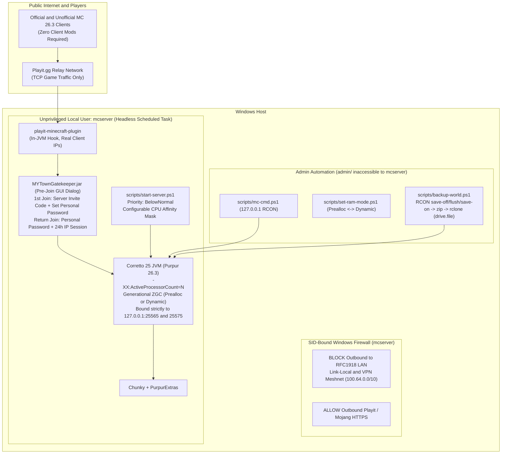

# MY-Town — Security-Hardened Windows Minecraft Server (Purpur 26.3)

A security-first, zero-port-forwarding Windows setup for hosting a **Purpur 26.3** Minecraft server for friends on a personal PC—supporting **both official and unofficial Minecraft clients** with **zero client-side mods**, strict **OS/network isolation**, **CPU core pinning**, **elastic/preallocated Generational ZGC RAM toggling**, and **least-privilege daily Google Drive backups**.

> **Note:** No third-party `.jar` binaries, installers, or credentials are bundled in this repository. Use [`scripts/bootstrap-server.ps1`](scripts/bootstrap-server.ps1) (or the manual download links below) to pull official upstream builds directly.

---

## Security & Isolation Architecture



### Defense-in-Depth Highlights

| Layer | Control | Purpose |
| :--- | :--- | :--- |
| **Account Isolation** | Dedicated local user `mcserver` (`Users` only, `UserMayChangePassword = $false`) | Even if a plugin or JVM exploit occurs, the process has zero Administrator or privileged group rights. |
| **NTFS ACLs** | `admin/` and `backups/` explicitly **Deny** `mcserver`; `scripts/`, `Corretto/`, `libraries/`, `versions/`, `purpur-*.jar`, and `plugins/*.jar` are **Read & Execute (`RX`) only** | Prevents the game server from reading RCON/rclone secrets, tampering with backup archives, or modifying its own binaries/startup scripts. |
| **SID Firewall** | Windows Defender Firewall rules bound to `mcserver`'s SID (`D:(A;;CC;;;<SID>)`) | Blocks `mcserver` from initiating outbound connections to RFC1918 LAN subnets (`10.0.0.0/8`, `172.16.0.0/12`, `192.168.0.0/16`), link-local (`169.254.0.0/16`), and VPN Meshnet/CGNAT (`100.64.0.0/10`), plus blocks direct inbound connections to `java.exe`. |
| **Loopback Binding** | `server-ip=127.0.0.1` in `server.properties` | Exposes neither the game port (`25565`) nor RCON (`25575`) on LAN or VPN interfaces. |
| **In-JVM Tunneling** | `playit-minecraft-plugin.jar` inside the unprivileged JVM | Unlike the standalone `playit` daemon (which can map arbitrary localhost/LAN ports from the web dashboard), the plugin only routes Minecraft TCP traffic and preserves real player IPs for logging and rate-limiting. |
| **Least-Privilege Backups** | `rclone` configured under Admin context with `scope = drive.file` | Restricts Google Drive OAuth access strictly to the `MY-Town-Backups` folder created by `rclone`; `mcserver` cannot read `admin/rclone.conf`. |

---

## `MYTownGatekeeper` Pre-Join GUI Authentication

Located in [`src/MYTownGatekeeper`](src/MYTownGatekeeper), this zero-dependency Purpur 26.3 plugin hooks into Paper's **Configuration-Phase Dialog API** (`AsyncPlayerConnectionConfigureEvent`, `PlayerCustomClickEvent`, `io.papermc.paper.dialog.Dialog`) so connecting players cannot load world chunks, spawn entities, or type in chat until authenticated:

1. **Both Official & Unofficial Clients Supported (`online-mode=false`):** Friends don't need client-side mods or manual whitelisting.
2. **First-Time Registration Modal:** Prompts for two secrets in a native Minecraft GUI dialog:
   - **Server Invite Code** (verified in constant time using `MessageDigest.isEqual`) — keeps automated server scanners and uninvited users out without maintaining a whitelist.
   - **Personal Account Password** (hashed with salted `PBKDF2WithHmacSHA256`, 65,536 iterations, 16-byte `SecureRandom` salt) — prevents anyone else (even another invited friend) from impersonating your username or another player's username.
3. **Returning Player Login Modal:** Automatically resumes valid IP sessions within `session-ttl-hours` (default `24`) or prompts for the player's personal password.
4. **Brute-Force Lockout:** Enforces configurable failed-attempt lockouts (`max-failed-attempts: 5`, `lockout-minutes: 15`) per real IP and username, rejecting locked-out IPs at `PlayerConnectionValidateLoginEvent`.

---

## Prerequisites & Official Third-Party Downloads

Download these official upstream tools/jars yourself (or pass `-DownloadDeps` to `bootstrap-server.ps1` for the Purpur and plugin jars):

| Component | Official Source | Notes |
| :--- | :--- | :--- |
| **Amazon Corretto 25 JDK** | [aws.amazon.com/corretto](https://aws.amazon.com/corretto/) | Required by Minecraft `26.3` and to compile `MYTownGatekeeper.jar`. Place under `Corretto\` in the server folder or install system-wide. |
| **Purpur 26.3** | [purpurmc.org/downloads](https://purpurmc.org/downloads) | Place `purpur-26.3-*.jar` in the server root. |
| **Playit.gg Minecraft Plugin** | [github.com/playit-cloud/playit-minecraft-plugin/releases](https://github.com/playit-cloud/playit-minecraft-plugin/releases) | Place `playit-minecraft-plugin.jar` in `plugins\`. Do **not** run the standalone `playit.exe` daemon if using this setup. |
| **Chunky** | [modrinth.com/plugin/chunky](https://modrinth.com/plugin/chunky) | Pre-generates spawn terrain to avoid exploration CPU spikes. |
| **PurpurExtras** | [modrinth.com/plugin/purpurextras](https://modrinth.com/plugin/purpurextras) | Optional Purpur quality-of-life plugin (`plugins\`). |
| **Rclone** | [rclone.org/downloads](https://rclone.org/downloads/) (`winget install Rclone.Rclone`) | Used by `scripts\backup-world.ps1` for `drive.file`-scoped backups. |

---

## Quick Start Guide

### 1. Clone and Bootstrap
```powershell
git clone https://github.com/filipzarzynski/Minecraft-MY-Town.git MY-Town
cd MY-Town

# Option A: Automatically fetch Purpur 26.3, Playit plugin, Chunky, and PurpurExtras from official APIs
powershell -ExecutionPolicy Bypass -File .\scripts\bootstrap-server.ps1 -DownloadDeps -AcceptEula

# Option B: If you already downloaded purpur-*.jar and plugins\*.jar manually
powershell -ExecutionPolicy Bypass -File .\scripts\bootstrap-server.ps1 -AcceptEula
```
This generates cryptographic secrets in `admin\` (`mcserver-password.txt`, `rcon-secret.txt`, `invite-code.txt`), unpacks Purpur's libraries, compiles `plugins\MYTownGatekeeper.jar`, and renders `server.properties` and `eula.txt`.

### 2. Authorize Google Drive Backups (`drive.file` scope)
```powershell
rclone config create gdrive drive scope drive.file --config .\admin\rclone.conf
```
Complete the one-time browser OAuth consent prompt. Because of `scope = drive.file`, `rclone` can only access files it creates inside `gdrive:MY-Town-Backups`.

### 3. Tune CPU Affinity & RAM Profile (Optional)
Edit [`scripts/ram-mode.json`](scripts/ram-mode.json) to match your CPU topology before hardening:
- `ActiveProcessorCount`: Number of cores exposed to the JVM (`-XX:ActiveProcessorCount`).
- `AffinityMask`: Windows processor bitmask in decimal:
  - **6-core CPU (e.g. i7-8700K no-HT), reserve Cores 0–2 for desktop, pin JVM to Cores 3–5:** `56` (`0x38` = binary `111000`)
  - **8-core CPU, pin JVM to last 4 cores (Cores 4–7):** `240` (`0xF0` = binary `11110000`)
  - **12-thread CPU, pin JVM to last 6 threads (Threads 6–11):** `4032` (`0xFC0`)

### 4. Harden Host, Firewall, ACLs & Start Server (Administrator PowerShell)
Open **Terminal (Admin)** and run:
```powershell
powershell -ExecutionPolicy Bypass -File .\scripts\harden-environment.ps1
```
This creates/hardens `mcserver`, locks down NTFS permissions, creates the SID-bound firewall rules, grants `SeBatchLogonRight`, registers `MY-Town-Minecraft-Server` (boot startup) and `MY-Town-Daily-Backup` (`04:30 AM` daily), and starts the server.

### 5. Claim Playit.gg Tunnel
Check `logs\latest.log` for the one-time claim URL printed by `playit-gg`:
```powershell
Select-String -Path .\logs\latest.log -Pattern 'playit\.gg/claim'
```
Open that link in your browser to bind the tunnel to your Playit.gg account and get your public join address.

### 6. Apply Casual Gameplay Rules & Pre-Generate World
Once the server is up, run via RCON:
```powershell
# Friendly survival defaults (Minecraft 26.3 snake_case gamerules)
.\scripts\mc-cmd.ps1 "gamerule keep_inventory true"
.\scripts\mc-cmd.ps1 "gamerule players_sleeping_percentage 25"
.\scripts\mc-cmd.ps1 "execute in minecraft:the_nether run gamerule keep_inventory true"
.\scripts\mc-cmd.ps1 "execute in minecraft:the_end run gamerule keep_inventory true"

# Grant yourself operator status after joining once (or by username)
.\scripts\mc-cmd.ps1 "op <YourUsername>"

# Pre-generate a 3,000-block Overworld spawn radius with Chunky
.\scripts\mc-cmd.ps1 "chunky world world"
.\scripts\mc-cmd.ps1 "chunky center 0 0"
.\scripts\mc-cmd.ps1 "chunky radius 3000"
.\scripts\mc-cmd.ps1 "chunky start"
```
To disable Creeper block destruction while keeping combat damage and villager farming intact, set `creeper.allow-griefing: false` in the generated `purpur.yml` and run `.\scripts\mc-cmd.ps1 "purpur reload"`.

---

## Day-to-Day Administration

```powershell
# Send any console command over localhost RCON (127.0.0.1:25575)
.\scripts\mc-cmd.ps1 "list"
.\scripts\mc-cmd.ps1 "chunky progress"

# Manage Gatekeeper invites & player passwords
.\scripts\mc-cmd.ps1 "gatekeeper status"
.\scripts\mc-cmd.ps1 "gatekeeper setinvite NEW-SECRET-CODE"
.\scripts\mc-cmd.ps1 "gatekeeper resetpassword <Username>"
.\scripts\mc-cmd.ps1 "gatekeeper clearlockout all"

# Switch RAM mode between fixed 12 GB Prealloc and 2-12 GB Dynamic ZGC uncommit
.\scripts\set-ram-mode.ps1 -Mode Dynamic                 # Applies on next boot/restart
.\scripts\set-ram-mode.ps1 -Mode Prealloc -RestartServerNow

# Run an immediate backup test
.\scripts\backup-world.ps1
```

---

## Migrating to Mods (Fabric / NeoForge) Later
If you later decide to switch from Purpur plugins to a mod loader like **Fabric** or **NeoForge**, your world saves, chests, builds, and player inventories carry over without starting from scratch:
1. Back up the entire server directory.
2. On Minecraft `26.1+` / `26.3`, Paper/Purpur stores 5 global `.dat` files (`game_rules.dat`, `scheduled_events.dat`, `wandering_trader.dat`, `weather.dat`, `world_gen_settings.dat`) in `world/dimensions/minecraft/overworld/data/minecraft/`; move them into `world/data/minecraft/` when switching to Vanilla/Fabric/NeoForge.
3. Replace `plugins/` with `mods/` (Bukkit/Paper plugins are incompatible with Fabric/NeoForge mods). Note that newly added modded ores/biomes only generate in unexplored chunks unless you trim unused chunks with a tool such as MCA Selector.

---

## License
[MIT License](LICENSE)
